<p align="center"></p>

<h1 align="center">Farol</h1>

<p align="center">A desk lamp for your Paseo agents · <a href="README_CN.md">中文</a></p>

Farol is a desk lamp for your [Paseo](https://paseo.sh) agents. It runs on an ESP-Mosaico board. You see how your agents are doing at a glance, and you can answer them, stop them and start new ones without opening the app.

<p align="center">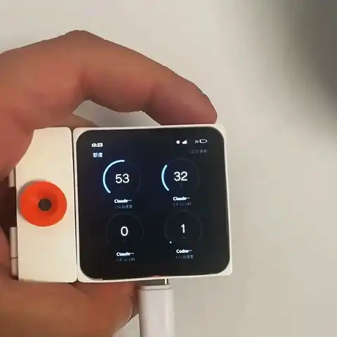</p>

<p align="center">A real board, set to Chinese: ask by voice, hold Send, and the session runs to its answer.</p>

- The light shows the state of all your agents. It breathes cool while they work, turns amber when one waits for you and red when a turn fails. Its height follows your tightest usage quota.
- Behind the lamp is a deck of cards, one per agent. Hold an option to answer a question, a permission request or a plan. Hold a running card to stop the turn.
- Hold the AI key and speak to start a new session. Paseo's own dictation turns your voice into the first prompt. You can also type it.
- The board and the plugin speak Chinese or English and follow the Paseo app.

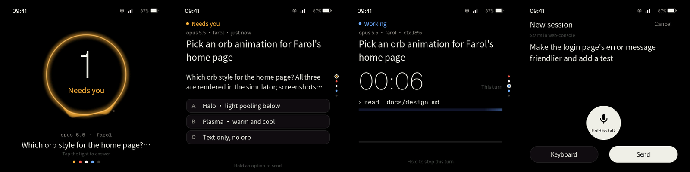

## What you need

- An ESP-Mosaico board. The camera module in the left slot scans Wi-Fi codes and Paseo's pairing code. The interaction module in the right slot is optional. With it, the screen wakes when you come near and follows the room's light, and the LEDs show the lamp's state.
- Paseo 0.14 or later with plugins on. To start sessions by voice, set up dictation in Paseo.
- To build the firmware, an [ESP-Mosaico workspace](https://github.com/esp-mosaico/esp-mosaico-vibe) with its submodules, Python 3.10 or later and Rust stable. rustup installs the board's target from `rust/rust-toolchain.toml`.

## Install

1. Put this repository at `projects/farol` in the workspace. From the workspace root, build the firmware and install it on the board:

   ```sh
   python mosaico.py iris system-update --project projects/farol
   ```

   The camera driver patches ESP-IDF when the project configures, so the build stops on an unpatched ESP-IDF. Build against a private copy as the [development guide](docs/development.md#esp-idf-with-the-camera-patch) shows, or set `FAROL_ALLOW_IDF_PATCH=1` to let it patch the workspace's copy.

2. On the computer that runs the Paseo daemon, install the plugin:

   ```sh
   cd plugin && npm install && npm run check
   paseo plugin install "$PWD" --id farol
   ```

## Connect a board

1. Join Wi-Fi (2.4 GHz). On the "No Wi-Fi" page, scan the network code from your phone's Wi-Fi settings, or choose a network and type its password.
2. Connect to Paseo in one of the two ways Paseo's app offers.
   - Scan QR code, an encrypted relay connection. In Paseo, open Settings › your host › Pair device and scan the code with the board. The first time, Paseo asks to turn on its relay. The board then works from any network, end-to-end encrypted to your daemon.
   - Direct connection, on a local network or a VPN. Type the host, the port (empty means 6767), SSL on or off and the daemon password.
3. The board shows which Paseo it is about to join. Tap Connect. When the daemon has a password that the pairing code did not carry, the board asks for it.

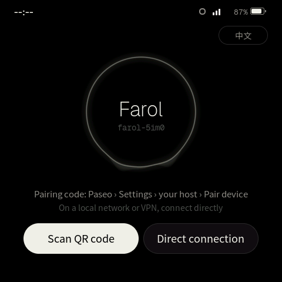

## Use it

| Where | Gesture | Result |
|---|---|---|
| Anywhere | Swipe left or right | Usage, lamp, cards |
| Anywhere | Pull down from the top | Control centre: Wi-Fi, Paseo, do not disturb, sound, haptics, brightness |
| Lamp | Tap | The most urgent card |
| Lamp | Hold | A new session. Hold the light again to talk. |
| Cards | Swipe up or down | The next agent, most urgent first |
| A question | Hold an option for 0.5 s | Sends that answer |
| A running card | Hold for 1.2 s | Stops this turn. Let go early to cancel. |
| A finished card | Tap Mark read | The button checks, the card leaves the deck and the next card says how many are left. After the last card the board goes back to the lamp. A card comes back when its agent starts something new. |
| AI key | Click | The most urgent card. Click again to go back to the lamp. |
| AI key | Hold | Talk. Let go, check the text, hold Send. |
| The board | Turn face down | Do not disturb while it lies there |

A tap never changes an agent. Only a hold does.

### Answer a question

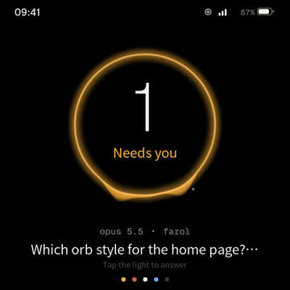

### Stop a turn

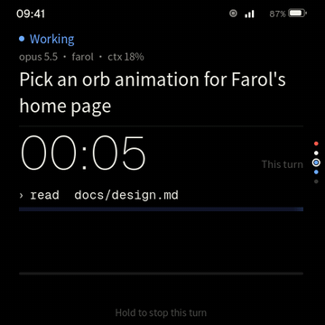

### Start a session by voice

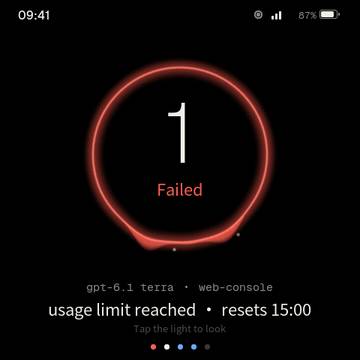

Hold the AI key and talk. The lamp turns violet and rises and falls with your voice. Let go, and Paseo turns the words into text. The text shows as the card the session will be. Hold Send until the bar fills, and the new session's card opens. To redo, hold the AI key again.

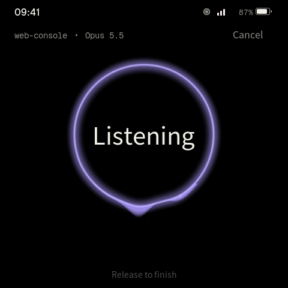 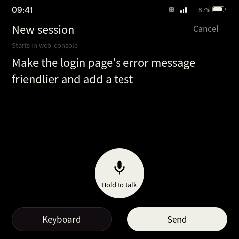 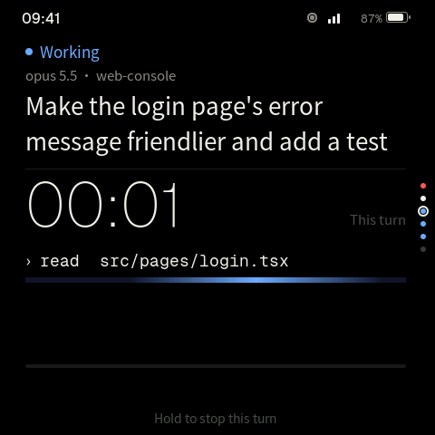

The session starts in the workspace and with the agent profile you pick in the plugin's settings. The board's keyboard has Latin letters only, so speak to write Chinese. Paseo's dictation does the speech-to-text with the provider set up in Paseo. If it mishears your language, set `features.dictation.stt.language` in the daemon's config.

### Other pages

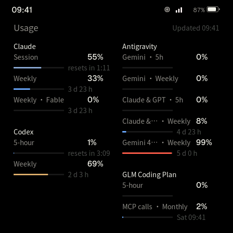 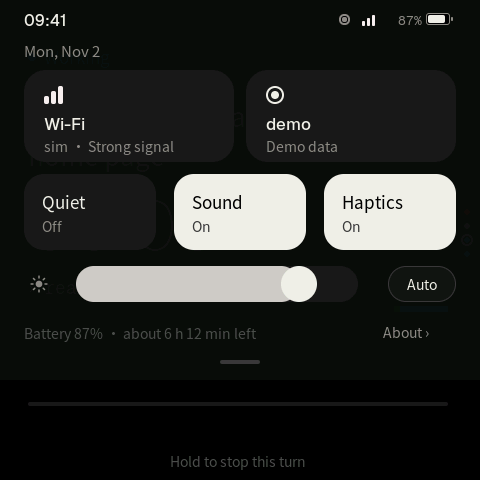 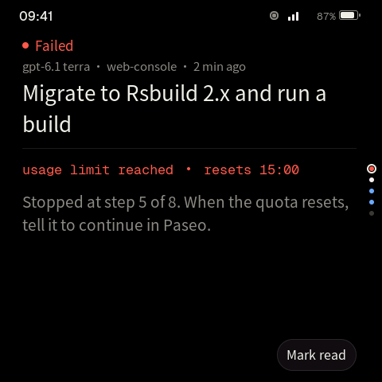

## Plugin settings

In Paseo, open Settings › Plugins › Farol.

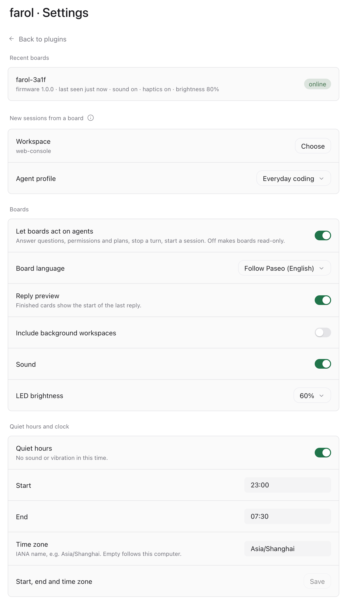

- Recent boards, with their firmware and their own sound, haptics and brightness.
- New sessions from a board. Pick a workspace and an agent profile. Boards can start sessions only when both are set.
- Let boards act on agents. Off makes every board read-only.
- Board language: follow Paseo, Chinese or English.
- Reply preview on finished cards, background workspaces, sound, LED brightness, quiet hours and the time zone of the board's clock.

## When the board can't connect

Pull down the control centre and tap Paseo. The page names the reason.

| The board says | What to do |
|---|---|
| Wrong daemon password | Tap Reconnect and connect again with the new password. |
| The relay can't reach this Paseo | Check that the daemon runs and its relay is on. |
| Encrypted connection failed | The daemon's key changed. Scan its pairing code again. |
| The Farol plugin isn't running in Paseo | Install the plugin, or turn it on in Paseo's plugin list. |
| The daemon doesn't accept this host (hostnames) | Add the host name to `daemon.hostnames` in the daemon's config. |
| SSL certificate not trusted | Use a certificate from a public CA, or turn SSL off on a network you trust. |
| Pick a default workspace in Paseo's Farol settings first | Set the workspace and the agent profile in the plugin's settings. |

## Security

The board keeps the daemon password, and for the relay the pairing code, in its flash without encryption. Anyone with the board and a USB cable can read them. The password gives full control of your daemon, and so does the pairing code when the daemon has no password. Keep the board with you, give the daemon a password, and change it if you lose the board.

## Development

Build steps, the simulator, tests and the board's protocol are in [docs/development.md](docs/development.md).

## License

Apache-2.0, see [LICENSE](LICENSE). The fonts are subsets of Noto Sans SC and Geist under the SIL Open Font License (`components/app_logic/ui/fonts/OFL-*.txt`).
