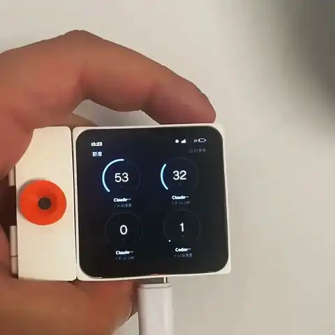
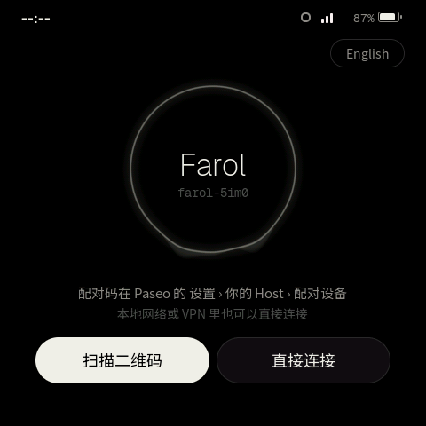
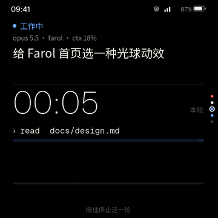
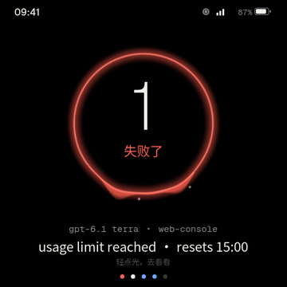
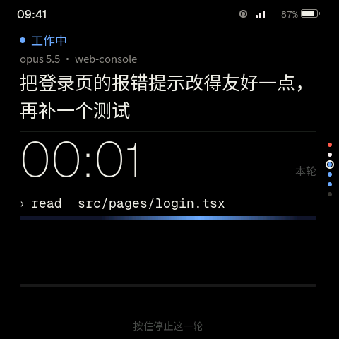
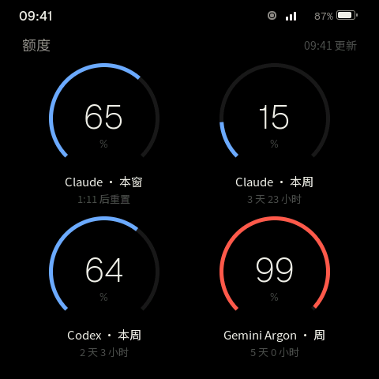
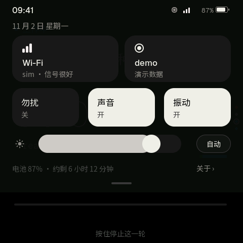
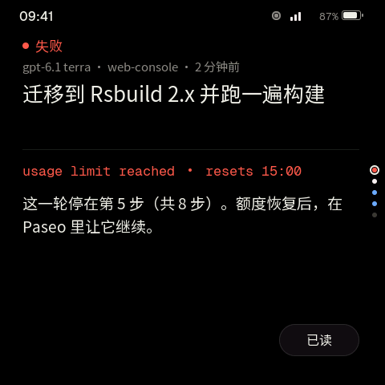
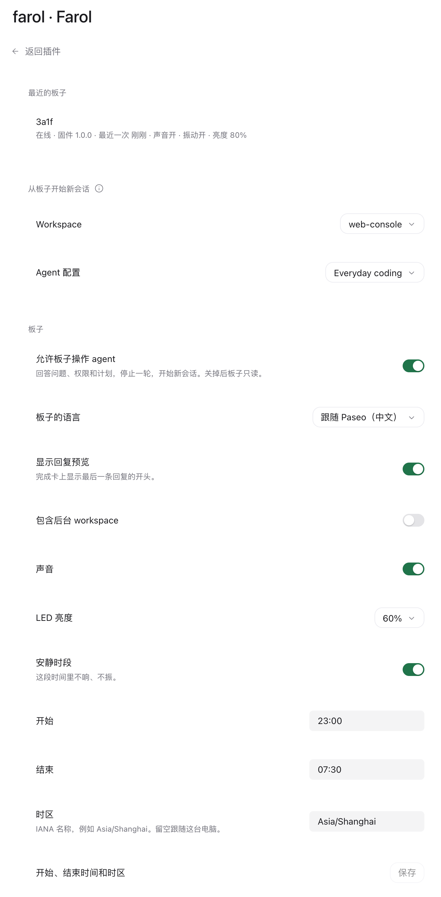

<p align="center"></p>

<h1 align="center">Farol</h1>

<p align="center">替你看着 Paseo agent 的桌面灯 · <a href="README.md">English</a></p>

Farol 是一盏放在桌上的灯，替你看着 [Paseo](https://paseo.sh) 里的 agent，跑在 ESP-Mosaico 开发板上。看一眼就知道 agent 们怎么样了。不打开 App 也能回答和停止它们，还能开新会话。

<p align="center"></p>

<p align="center">真机演示：用语音提问，按住发送，会话一直跑到给出答案。</p>

- 灯光反映所有 agent 的状态。都在干活时是冷色、慢慢呼吸，有 agent 等你时变琥珀色，一轮失败时变红。光的高低跟着你最紧的那份额度走。
- 灯后面是一叠卡片，一个 agent 一张。按住选项就能回答问题、权限请求或计划，按住运行中的卡片能停止这一轮。
- 按住 AI 键说话，就能开始一段新会话。Paseo 自己的语音输入把你说的话变成第一条消息，也可以打字。
- 板子和插件都有中文和英文，跟着 Paseo App 的语言走。


## 需要什么

- 一块 ESP-Mosaico 板子。左槽的摄像头模块用来扫 Wi-Fi 码和 Paseo 的配对码。右槽的交互模块可选，插上后屏幕随人亮灭、跟着环境光调亮度，LED 也会显示灯的状态。
- Paseo 0.14 或更新，并开启插件。想用语音开会话，要在 Paseo 里设置好语音输入。
- 构建固件需要一个 [ESP-Mosaico 工作区](https://github.com/esp-mosaico/esp-mosaico-vibe)（含子模块），以及 Python 3.10+ 和 Rust stable。板子的编译目标由 rustup 按 `rust/rust-toolchain.toml` 装上。

## 安装

1. 把本仓库放在工作区的 `projects/farol`，在工作区根目录构建固件并装到板子上：

   ```sh
   python mosaico.py iris system-update --project projects/farol
   ```

   摄像头驱动会在配置时给 ESP-IDF 打补丁，所以遇到没打补丁的 ESP-IDF，构建会停下。按[开发说明](docs/development.md#esp-idf-with-the-camera-patch)用一份私有副本构建，或者设置 `FAROL_ALLOW_IDF_PATCH=1`，让它直接给工作区的那份打补丁。

2. 在运行 Paseo daemon 的电脑上，从 [Paseo 的插件目录](https://paseo.sh/plugins/gtoxlili/farol)安装插件：

   ```sh
   paseo plugin add gtoxlili/farol
   ```

   以后用 `paseo plugin update farol` 更新到最新的审核版本。想直接运行本仓库里的插件代码，见[开发说明](docs/development.md#the-plugin-from-a-checkout)。

## 连接板子

1. 连 Wi-Fi（2.4 GHz）。在板子的“没有连上 Wi-Fi”页上扫手机 Wi-Fi 设置里出示的网络二维码，或者选一个网络、输入密码。
2. 连 Paseo，方式和 Paseo App 添加连接时一样，二选一。
   - 扫描二维码，走加密 relay 连接。在 Paseo 里打开 设置 › 你的 Host › 配对设备，用板子扫出现的码。第一次打开时 Paseo 会问你要不要启用中继。之后板子在任何网络下都能连上，和 daemon 之间端到端加密。
   - 直接连接，适合本地网络或 VPN。填 Host、端口（留空就是 6767）、是否用 SSL 和 daemon 密码。
3. 板子会先告诉你要连的是哪台 Paseo，点“连接”。daemon 设了密码而配对码里没带时，板子会再问你要。



## 怎么用

| 在哪 | 手势 | 结果 |
|---|---|---|
| 任何地方 | 左右滑 | 额度、灯、卡片组 |
| 任何地方 | 从顶部下拉 | 控制中心，含 Wi-Fi、Paseo、勿扰、声音、振动和亮度 |
| 灯 | 轻点 | 最紧急的那张卡 |
| 灯 | 按住 | 新会话，再按住光说话 |
| 卡片组 | 上下滑 | 下一个 agent，最紧急的排在前面 |
| 提问卡 | 按住一个选项 0.5 秒 | 用这个选项回答 |
| 运行中的卡 | 按住 1.2 秒 | 停止这一轮，提前松手就取消 |
| 完成的卡 | 点“已读” | 按钮打勾，卡片离开卡片组，下一张卡提示还剩几张；最后一张读完就回到灯。agent 开始新的一轮时，卡片再回来 |
| AI 键 | 单击 | 最紧急的那张卡，再按一次回到灯 |
| AI 键 | 按住 | 说话，松开后看一眼文字，按住“发送” |
| 板子 | 扣过来放 | 扣着的时候勿扰 |

轻点永远不会改动 agent，只有按住才会。

### 回答问题


### 停止一轮



### 用语音开会话



按住 AI 键说话，灯会变成紫色，跟着你的声音起伏。松开后 Paseo 把话转成文字，文字显示成这个新会话将来的卡片。按住“发送”直到条填满，新会话的卡片就打开了。想重说，就再按住 AI 键。

  

新会话开在插件设置里选的 workspace 里，用那里选的 agent 配置。板子的键盘只有英文字母，写中文就用说的。语音转文字由 Paseo 的语音输入完成，用的是你在 Paseo 里配好的服务。中文识别不准时，在 daemon 配置里把 `features.dictation.stt.language` 设成 `zh`。

### 其他页面

  

## 插件设置

在 Paseo 里打开 设置 › 插件 › Farol。



- 最近的板子，含固件版本，以及每块板子自己的声音、振动和亮度。
- 从板子开始新会话。选一个 workspace 和一个 agent 配置，两个都选了板子才能开会话。
- 允许板子操作 agent。关掉后所有板子只读。
- 板子的语言，可以跟随 Paseo，也可以固定成中文或英文。
- 还有完成卡的回复预览、后台 workspace、声音、LED 亮度、安静时段，以及板子时钟用的时区。

## 板子连不上时

下拉控制中心，点 Paseo，页面上会写明原因。

| 板子上显示 | 怎么办 |
|---|---|
| daemon 密码不对 | 点“重新连接”，用新密码再连一次。 |
| relay 联系不上这台 Paseo | 确认 daemon 在运行，并且开着中继。 |
| 加密连接失败 | daemon 的密钥换了，重新扫它的配对码。 |
| Paseo 里没有运行 Farol 插件 | 安装插件，或者在 Paseo 的插件列表里打开它。 |
| daemon 不认这个 Host（hostnames） | 把这个 Host 加进 daemon 配置里的 `daemon.hostnames`。 |
| SSL 证书无效 | 换成公开 CA 签发的证书，或者在可信的网络里关掉 SSL。 |
| 先在 Paseo 的 Farol 设置里选一个默认 workspace | 在插件设置里选好 workspace 和 agent 配置。 |

## 安全

板子把 daemon 密码，以及走中继时的配对码，明文存在 flash 里。拿到板子和一根 USB 线的人就能读出来。密码能完全控制你的 daemon，daemon 没设密码时配对码也一样。板子自己保管好，给 daemon 设一个密码，板子丢了就改掉它。

## 开发

构建、模拟器、测试和板子的协议见 [docs/development.md](docs/development.md)（英文）。

## 许可

Apache-2.0，见 [LICENSE](LICENSE)。字体是 Noto Sans SC 和 Geist 的子集，遵循 SIL Open Font License（`components/app_logic/ui/fonts/OFL-*.txt`）。
