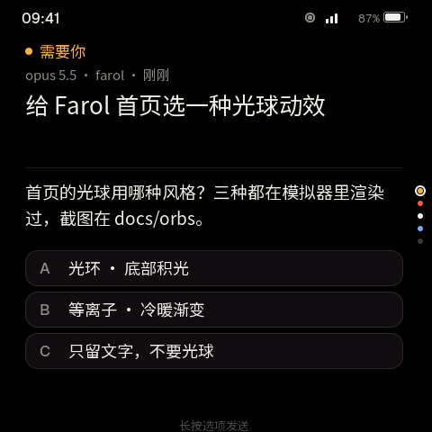
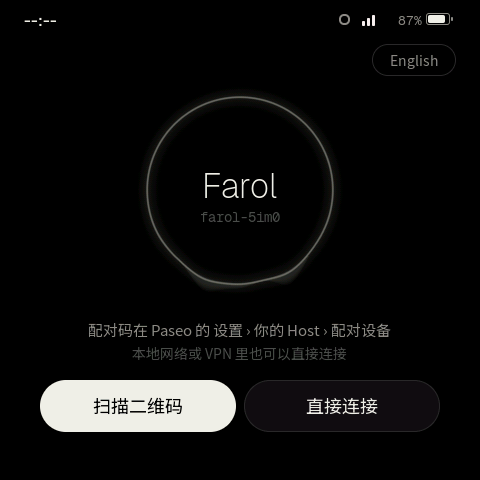
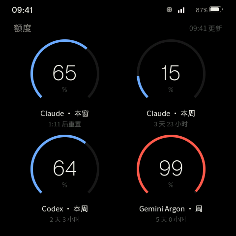
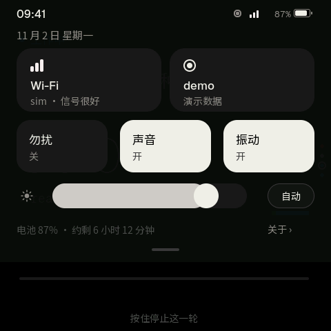

# Farol

Farol 是一盏放在桌上的灯，替你看着 [Paseo](https://paseo.sh) 里的 coding agent，跑在 ESP-Mosaico 开发板上。看一眼就知道 agent 们怎么样了；不打开 Paseo App，也能在板子上回答它们的问题、停止正在跑的一轮，或者用语音开一段新会话。

Farol 由两部分组成：板子上的固件，以及装在 Paseo daemon 上的 Farol 插件。插件把 Paseo 的状态整理好发给板子，并替板子执行你在上面做的操作。源码、构建说明和更新都在 GitHub：<https://github.com/gtoxlili/farol>。

[真机演示录像](https://github.com/gtoxlili/farol/blob/main/plugin/assets/demo.webp)（无声）：用语音提问，按住发送，新会话一直跑到给出答案。本页其余截图来自项目自带的模拟器，画面与板子上的界面相同。

## 它做什么

- **灯光反映所有 agent 的状态。** 都在干活时是冷色、慢慢呼吸；有 agent 等你时变琥珀色；一轮失败时变红。光的高低跟着你最紧的那份用量额度走。
- **一个 agent 一张卡片。** 灯后面是一叠卡片。按住选项就能回答问题、权限请求或计划；按住运行中的卡片能停止这一轮。
- **用语音开新会话。** 按住 AI 键说话，Paseo 自己的语音输入把你说的话变成第一条消息，按住“发送”就开始。也可以用板子的键盘打字（只有英文字母）。
- **中英文。** 板子和插件都有中文和英文，默认跟着 Paseo App 的语言。

  

## 需要的硬件和软件

- 一块 ESP-Mosaico 开发板。
- **摄像头模块，插在左槽**：用来扫 Wi-Fi 二维码和 Paseo 的配对码。
- 交互模块，插在右槽，可选：插上后屏幕随人亮灭、跟着环境光调亮度，LED 也会显示灯的状态。
- 一个 2.4 GHz Wi-Fi 网络。
- 一台运行 Paseo daemon 的电脑：Paseo 0.14 或更新，并开启插件。想用语音开会话，要在 Paseo 里设置好语音输入。

## 安装

本次发布的固件版本是 1.0.0。安装分两步，具体命令见仓库的[中文说明](https://github.com/gtoxlili/farol/blob/main/README_CN.md#安装)。

1. **固件。** 从源码构建时，把仓库放在 ESP-Mosaico 工作区的 `projects/farol`，用工作区的 `mosaico.py` 构建并安装到板子上。摄像头驱动需要给 ESP-IDF 打补丁，没打补丁的 ESP-IDF 会让构建停下，做法见[开发说明](https://github.com/gtoxlili/farol/blob/main/docs/development.md#esp-idf-with-the-camera-patch)（英文）。
2. **Paseo 插件。** 在运行 Paseo daemon 的电脑上，从 Paseo 的插件目录安装 [Farol](https://paseo.sh/plugins/gtoxlili/farol)，装好后在 Paseo 的插件列表里确认它已启用。

## 连接

1. **连 Wi-Fi。** 在板子的“没有连上 Wi-Fi”页上扫手机 Wi-Fi 设置里出示的网络二维码，或者选一个网络、输入密码。
2. **连 Paseo。** 方式和 Paseo App 添加连接时一样，二选一：
   - **扫描二维码**（加密中继）：在 Paseo 里打开 设置 › 你的 Host › 配对设备，用板子扫出现的码。之后板子在任何网络下都能连上，和 daemon 之间端到端加密。
   - **直接连接**（本地网络或 VPN）：填 Host、端口（留空为 6767）、是否用 SSL 和 daemon 密码。
3. 板子会先显示要连的是哪台 Paseo，点“连接”。daemon 设了密码而配对码里没带时，板子会再问一次密码。

## 使用

| 在哪 | 手势 | 结果 |
|---|---|---|
| 任何地方 | 左右滑 | 额度、灯、卡片组 |
| 任何地方 | 从顶部下拉 | 控制中心：Wi-Fi、Paseo、勿扰、声音、振动和亮度 |
| 灯 | 轻点 | 最紧急的那张卡 |
| 灯 | 按住 | 新会话，再按住光说话 |
| 卡片组 | 上下滑 | 下一个 agent，最紧急的排在前面 |
| 提问卡 | 按住一个选项 0.5 秒 | 用这个选项回答 |
| 运行中的卡 | 按住 1.2 秒 | 停止这一轮，提前松手就取消 |
| 完成的卡 | 点“已读” | 卡片离开卡片组；agent 开始新的一轮时再回来 |
| AI 键 | 单击 | 最紧急的那张卡，再按一次回到灯 |
| AI 键 | 按住 | 说话，松开后看一眼文字，按住“发送” |
| 板子 | 扣过来放 | 扣着的时候勿扰 |

轻点永远不会改动 agent，只有按住才会。

**用语音开会话：** 按住 AI 键说话，灯变成紫色，跟着你的声音起伏。松开后 Paseo 把话转成文字，显示成这个新会话将来的卡片。按住“发送”直到条填满，新会话就开始了。想重说，再按住 AI 键。新会话开在插件设置里选的 workspace 里，用那里选的 agent 配置。

  

**其他页面：** 额度页列出各家服务的用量；控制中心里可以调声音、振动、亮度和勿扰。

 

## 插件设置

在 Paseo 里打开 设置 › 插件 › Farol：

- 最近连过的板子和它们的固件版本，以及每块板子自己的声音、振动和亮度。
- 从板子开始新会话用的 workspace 和 agent 配置。两个都选了，板子才能开会话。
- 是否允许板子操作 agent。关掉后所有板子只读。
- 板子的语言：跟随 Paseo，或固定成中文或英文。
- 完成卡的回复预览、是否包含后台 workspace、声音、LED 亮度、安静时段，以及板子时钟用的时区。

## 限制和注意事项

- 必须有摄像头模块才能扫码连接 Wi-Fi 和 Paseo 的中继配对码。
- 板子的键盘只有英文字母，写中文要用语音。语音转文字由 Paseo 的语音输入完成，用的是你在 Paseo 里配好的服务；中文识别不准时，在 daemon 配置里把 `features.dictation.stt.language` 设成 `zh`。
- 板子上的停止会在 daemon 那台电脑上运行 `paseo stop`。daemon 的 PATH 里没有 `paseo` 命令行时，板子不能停止一轮。
- 板子上的回答只有被 Paseo 采用才算数。你先在别处回答了，板子会告诉你。
- **安全：** 板子把 daemon 密码，以及走中继时的配对码，明文存在 flash 里，拿到板子和一根 USB 线的人就能读出来。它们能完全控制你的 daemon。板子自己保管好，给 daemon 设一个密码，板子丢了就改掉它。
- 板子连不上时，下拉控制中心，点 Paseo，页面上会写明原因；常见原因和处理办法见仓库 README 的“板子连不上时”一节。

## 许可

- Farol 的代码以 Apache-2.0 发布，见仓库的 [LICENSE](https://github.com/gtoxlili/farol/blob/main/LICENSE)。
- 固件里的字体是 Noto Sans SC 和 Geist 的子集，遵循 SIL Open Font License 1.1。
